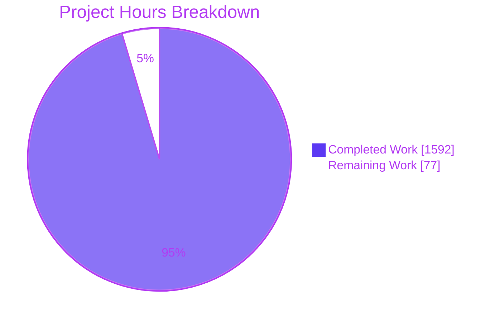
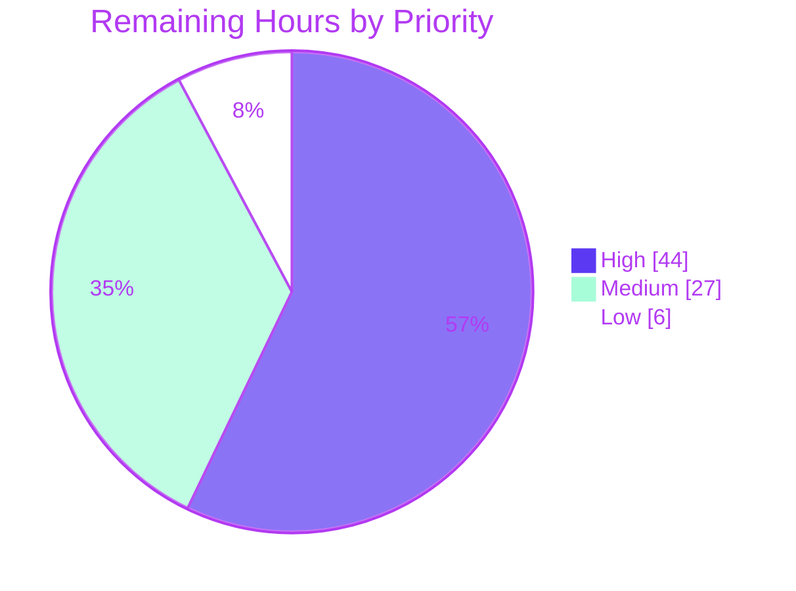

# 1. Executive Summary

## 1.1 Project Overview

RAMQuick is a portable, offline memory stability checker for Windows 10 and 11 x64 PCs, built for enthusiasts tuning BIOS memory speed, timings and voltages. It returns PASS, FAIL or ABORTED in about 5, 20 or 60 minutes (Quick, Standard, Exhaustive), with ranked cause hints that are labelled as hints. The project delivers a native C++20 engine (SSE2/AVX2/AVX-512 kernels, one pinned worker per logical processor, locked memory) behind a C ABI. Around it sit a .NET 8 WPF application with crash-consistent journalling, logs and summaries, sensor monitoring, a researched test methodology, and a one-command build and quality gate.

## 1.2 Completion Status


| Metric | Value |
|---|---|
| Total Hours | 1,669 |
| Completed Hours (AI + Manual) | 1,592 |
| Remaining Hours | 77 |
| Percent Complete | 95.4 % |

1,592 hours completed out of 1,669 total hours = 95.4 % complete. The remaining 77 hours are hardware validation on the user's validation PC, release preparation and small hardening items.

## 1.3 Key Accomplishments

- ✅ Engine: 1,131 native tests pass, covering patterns, access orders, scheduling and memory locking.
- ✅ Every injected fault class is detected with the correct address, bit and step, and gets the expected top cause hint.
- ✅ Stop halts within 2 s at every point (slowest timed engine stop 20.9 ms), and memory is released on every exit path.
- ✅ A run killed mid-step is reported as FAIL at the next launch, with a partial summary.
- ✅ Full-length Quick, Standard and Exhaustive runs finish within ±0.25 % of their stated durations.
- ✅ All eight managed coverage groups exceed their minimums (91.4–100 %).
- ✅ `scripts\build.ps1 -Coverage` passes all 13 steps: 3,434 tests, 0 failures.
- ✅ The self-contained portable folder (277 files) starts with no runtime installed.

## 1.4 Critical Unresolved Issues

12 items are open: 2 of the AAP's 9 success criteria (fail-fast speed and no false failures) are unverified, 7 hardware-validation procedures from AAP 0.8.2 and 0.12.3 have not been run, and 3 release items remain. None is a failing test.

| Issue | Impact | Owner | ETA |
|---|---|---|---|
| Success criteria 1 and 2 unverified (2 items). Quick must FAIL within 5 min in ≥ 9 of 10 runs and be ≥ 5× faster than the fastest baseline. There must be no false FAIL on the passing and JEDEC profiles | Release sign-off cannot be given; a miss means retuning `src/RamQuick.Plans/TestPlans.cs` | Validation owner | 1–2 weeks (≈ 40 h machine time) |
| Validation-PC procedures not run (7 items): full-scale confirmation of criteria 5–7, `RamQuick.exe` kill-and-relaunch, real sensors with PawnIO, layout at 100/150/200 %, HWiNFO64 stress bound, Process Monitor capture, clean Windows 10/11 offline run | Behaviour on target hardware and clean machines is unproven | Validation owner | Same campaign |
| .NET 8 support ends 10 Nov 2026 (1 item) | The app would ship on an unsupported runtime | Maintainer | Before 10 Nov 2026 |
| `.log` neutralisation gap (1 item). Format characters such as U+202E, and U+2028/U+2029, are written unchanged inside quoted values (`src/RamQuick.Logging/ResultsLog.cs:1932`) | A crafted step or fault text can display misleadingly in the local `.log` | Maintainer | 3 h |
| Release packaging (1 item). `ramquick_engine.dll` has no version resource, and the portable folder ships 7 PDBs, 7 XML docs and `createdump.exe` | Support and antivirus friction; larger download | Maintainer | 4 h |

## 1.5 Access Issues

| System/Resource | Type of Access | Issue Description | Resolution Status | Owner |
|---|---|---|---|---|
| Validation PC with reproducible passing and failing BIOS profiles | Hardware | Not available to automated validation; success criteria 1 and 2 depend on it | Open; the user supplies it | Validation owner |
| PawnIO driver | Driver on the test machine | Not installed on the build machines, so real temperature readings are untested | Open; install on the validation PC | Validation owner |
| "Lock pages in memory" (`SeLockMemoryPrivilege`) | OS privilege | Not held on the build host, so the large-page path ran only on a second test machine | Accepted; RAMQuick never assigns privileges by design | Validation owner |
| Clean Windows 10 and Windows 11 x64 desktops | Test machines | Not available, so the offline portable run is unverified | Open | Release owner |

## 1.6 Recommended Next Steps

1. [High] Run the validation campaign in `docs/METHODOLOGY.md`, then paste the `scripts\Summarize-ValidationRuns.ps1` tables into it.
2. [High] Review and squash-merge the branch.
3. [Medium] Retarget to .NET 10, with Visual Studio 2026 Build Tools, before 10 Nov 2026.
4. [Medium] Close the `.log` neutralisation gap and settle what the portable folder ships.
5. [Low] Decide the toolchain pin and the 44-DIP touch-target question.

# 2. Project Hours Breakdown

Total project hours are 1,669: 1,592 completed plus 77 remaining. 1,592 ÷ 1,669 = 95.4 % complete. Every row traces to an AAP requirement or a path-to-production activity.

## 2.1 Completed Work Detail

| Component | Hours | Description |
|---|---|---|
| Native engine core and C ABI (AAP 0.3.1, 0.5.3.1, 0.5.4.1) | 320 | `src/engine`: session coordinator, system probe, QPC clock, chunked memory locking with retry and prefault, SSE2/AVX2/AVX-512 kernels with ISA dispatch, patterns, five access orders, step runner, worker pool across processor groups, error collector with re-read classification, `ramquick_engine.h` with layout asserts |
| Native test suite and test-only DLL (AAP 0.5.3.3, 0.8.3) | 160 | `tests/engine.tests`: 12 GoogleTest files, counting and fault-injecting memory layers, fake clock, and `ramquick_engine_test.dll` with fault-injection and counting exports (1,131 tests) |
| Managed interop (AAP 0.5.3.2) | 64 | `src/RamQuick.Interop`: `LibraryImport` bindings, callback thunks, session lifetime and safe handle, event marshalling to the UI context, result-code mapping, work-area query |
| Core run model (AAP 0.3.3) | 20 | `src/RamQuick.Core`: run state machine with terminal precedence, shared records and enums, error grouping |
| Test plans and validator (AAP 0.5.4.2) | 26 | `src/RamQuick.Plans`: Quick 6 / Standard 12 / Exhaustive 19 steps with exact budgets and holds, validator, and catalogue tests |
| Cause-hint analyzer (AAP 0.5.5) | 68 | `src/RamQuick.Analysis`: six signature rules, prior map, ranking and tie-break, suggestions, hint label, plus synthetic and injected-signature tests |
| Sensors and memory inventory (AAP 0.5.1) | 68 | `src/RamQuick.Sensors`: single-thread monitor with staleness and hang watchdog, thermal limits, LibreHardwareMonitor source, SMBIOS Type 17 parser, plus tests and fixtures |
| Logging, journal and crash recovery (AAP 0.5.2) | 230 | `src/RamQuick.Logging`: durable progress journal, crash detection and rebuild, results log, JSON and text summaries, data-folder link safety, personal-path redaction, plus 603 tests |
| WPF application (AAP 0.3.4, 0.5.6, 0.5.7) | 250 | `src/RamQuick.App`: single window and layouts, work-area sizing, view models, `RunController` orchestration, memory sizing, elevation, single instance, platform check, plus 730 tests |
| Integration tests and headless host (AAP 0.8.3) | 100 | `tests/RamQuick.IntegrationTests` (marshalling, lifetime, fault injection end to end, coverage and timing, process-level crash recovery, production binding) and `tests/RamQuick.TestHost` |
| Build and configuration (AAP 0.4, 0.6.2) | 20 | `RamQuick.sln`, `Directory.Build.props`, `Directory.Packages.props`, 14 lock files, `vcpkg.json`, `global.json`, `.editorconfig`, `.clang-format`, `.gitignore`, `engine.props` |
| Scripts (AAP 0.3.1, 0.8.2) | 90 | `scripts/build.ps1` (13-step gate), `check-constraints.ps1` (forbidden-API scan), `publish-portable.ps1`, `Summarize-ValidationRuns.ps1` (censored-interval statistics, HWiNFO stress-bound, 40-case self-test) |
| Methodology, README and notices (AAP 0.2.4.4, 0.4.1) | 56 | `docs/METHODOLOGY.md` (tool and tuning research, step-to-mechanism map, validation templates), `README.md`, `THIRD-PARTY-NOTICES.txt` with MPL source entries |
| Verification and hardening (AAP 0.8.1, 0.8.3, 0.12.1) | 120 | Full-length runs, second-machine runtime checks, security and accessibility hardening, and stop-latency and crash-path verification across all modules |
| **Total** | **1,592** | |

## 2.2 Remaining Work Detail

| Category | Hours | Priority |
|---|---|---|
| Validation-PC campaign (AAP 0.8.2): criteria 1–2 baselines and RAMQuick runs, full-length confirmations, kill-and-relaunch, PawnIO sensors, UAC decline | 16 | High |
| Stress-bound HWiNFO64 measurement and Process Monitor capture (AAP 0.12.3, 0.8.2) | 6 | High |
| Clean Windows 10/11 offline run, plus layout review at 100/150/200 % and across monitors (AAP 0.5.7, 0.8.2) | 6 | High |
| Code review and squash-merge of the branch (path to production) | 16 | High |
| Criterion-1 retune contingency, and recording results in `docs/METHODOLOGY.md` (AAP 0.8.2) | 6 | Medium |
| Retarget to .NET 10: VS 2026 Build Tools, script version range, lock files, full gate (AAP 0.3.2, path to production) | 12 | Medium |
| Release packaging: engine version resource; PDB, XML doc and `createdump.exe` policy (path to production) | 4 | Medium |
| Residual fixes: `.log` neutralisation, `RunControllerTests.cs` formatting (AAP 0.5.2) | 3 | Medium |
| Release build, zip, checksum and release notes (path to production) | 2 | Medium |
| Toolchain pin decision (AAP 0.4.2) | 2 | Low |
| Accessibility: 44-DIP touch targets, automation peers for the fixed result area (AAP 0.5.7) | 4 | Low |
| **Total** | **77** | |

# 3. Test Results

All figures come from one run of `scripts\build.ps1 -Coverage` at commit `0341fad`, Release|x64, in which all 13 gate steps passed. The seven compiled suites ran 3,434 tests: 3,431 passed, 3 skipped, 0 failed. The gate's 40-case summarizer self-test runs separately and is listed in the last row. The `Long` category (full-length plans, about 85 minutes) is excluded from the default gate; Section 4 records its results.

| Area / Category | Framework | Tests | Passed | Failed | Coverage | What This Proves |
|---|---|---|---|---|---|---|
| Native engine (`engine.tests`) | GoogleTest 1.18.0 | 1,131 | 1,129 (2 skipped) | 0 | Not measured | Kernels match the scalar reference on every ISA. Orders visit every byte once, the flush-before-verify rule holds, injected faults are caught, and stop ends within 2 s (max 20.9 ms) |
| Cause-hint analyzer | xUnit v3 | 380 | 380 | 0 | 99.6 % | Each injected signature ranks the expected cause first, with stable tie-breaks |
| Test plans | xUnit v3 | 111 | 111 | 0 | 100.0 % | Budgets, coverage targets, shared opening block, hold rule and the methodology map agree |
| Sensors and inventory | xUnit v3 | 327 | 326 (1 skipped) | 0 | 91.6 % | Per-sensor status, staleness at 3 s, hang at 5 s, thermal limits and SMBIOS parsing behave as specified |
| Logging, journal and recovery | xUnit v3 | 603 | 603 | 0 | 97.0 % | Journal acknowledgments and stalls, crash rebuild, crash-consistent publication, redaction and link-safe data folders |
| Application and core model | xUnit v3 | 730 | 730 | 0 | Services 91.4 %, view models 97.2 %, core 99.0 % | Controller edge cases, state-machine precedence, sizing, layout budgets, platform and elevation policy |
| Integration through the engine DLLs | xUnit v3 | 152 | 152 | 0 | Interop 93.9 % | Marshalling, session lifetime, fault injection end to end, coverage within 1 %, time remaining, UI responsiveness, process-level crash recovery |
| Validation-run summarizer self-test (separate from the 3,434) | PowerShell 5.1 | 40 | 40 | 0 | — | Censored-median intervals, criteria decisions and HWiNFO stress-bound import compute correctly |

The gate's static checks also passed: the forbidden-API scan (114 files), `clang-format --dry-run --Werror` (49 files), the MPL notices check (4 packages) and the locked-mode build.

**Not Covered**

- Large-page allocation (`MemoryRegionLargePages`) skips without `SeLockMemoryPrivilege`, so this gate does not exercise it. Rerun it on the release machine with the privilege held.
- Real temperature readings (`LibreHardwareMonitorSmokeTests`, `Requires=Hardware`) need PawnIO and an elevated process. Test them on the validation PC.
- Refusing a forced ISA the CPU lacks is covered only synthetically, because this CPU supports every set (`ApiBoundaryIsaHost`). Test it on a CPU without AVX-512.
- `RamQuick.TestHost` exit codes 1 and 5 have no process-level test.
- Declining the UAC prompt (Windows error 1223) is a manual check.
- Platform refusal on real Arm64 and pre-14393 builds is tested only at unit level.
- A real monitor-to-monitor DPI change (`WM_DPICHANGED`) has not been tested.
- The `pwsh` fallback path in `scripts\build.ps1` is untested.
- Native C++ line coverage is not measured by the toolchain.

# 4. Runtime Validation & UI Verification

- ✅ **Build and gate:** `RamQuick.sln` builds Release|x64 with 0 warnings under locked-mode restore, and `scripts\build.ps1 -Coverage` passes 13 of 13 steps.
- ✅ **Application startup:** the published `RamQuick.exe` shows its window in 0.87 s, with the three input controls, Quick selected and Stop on error checked. The notice line reads "Temperature sensors unavailable — thermal safety inactive", and no dialog appears.
- ✅ **Primary journey, headless:** `RamQuick.TestHost` ran 256 MiB, 2 steps → PASS, with `.log`, JSON and text summaries published and memory released in 0.031 s.
- ✅ **Primary journey, real UI:** with Start pressed in the published `RamQuick.exe` on an 8 GB, 2-processor machine, three full Quick runs gave PASS in 303.7–305 s, testing 4.3–4.5 GiB.
- ✅ **Full-length plans (`Long`, 1 GiB):** Quick 300.7 s, Standard 1,201.1 s and Exhaustive 3,601.5 s, all within ±0.25 %. Coverage targets were exceeded, and the verified bytes equal an independent count.
- ✅ **Stop and release:** stop to Completed took ≤ 35 ms during Preparing at 8–32 GiB, with the tested bytes released. A 24 GiB preparation kept the UI-thread probe under 4.7 ms.
- ✅ **Crash recovery:** a headless host killed mid-step was reported at the next launch as FAIL, with a partial summary rebuilt from the journal.
- ✅ **Portable package and offline behaviour:** the folder holds 277 files (66.0 MB zip) and no test DLL. No network endpoint was opened under an outbound block, and free memory returned to within 74 MiB of its pre-run level.
- ⚠ **Display scaling:** Compact and Minimal layouts were checked on real 200 % and 250 % displays. The 100/150/200 % review on the target monitors, and a move across monitors, remain to be done.
- ❌ **Never exercised:** hardware fail-fast and no-false-failure runs, real PawnIO temperatures, a full-size run (about 90 % of free RAM) on target hardware, large pages on the build host, the UAC decline path, and a clean Windows 10/11 offline run.

# 5. Compliance & Quality Review

## 5.1 Compliance Matrix

| AAP Deliverable | Benchmark | Status | Progress |
|---|---|---|---|
| Native engine, C ABI and test DLL (0.3.1, 0.5.3, 0.5.4.1) | `/W4 /WX /permissive-`, static CRT, eight undecorated exports, layout `static_assert`s, 1,131 tests | ✅ Pass | 100 % |
| Managed libraries: Core, Plans, Analysis, Interop (0.3.3, 0.5.3.2, 0.5.4.2, 0.5.5) | Warnings as errors, nullable on, XML docs; coverage ≥ 90 % (Core/Plans/Analysis) and ≥ 80 % (Interop) | ✅ Pass (99.0 / 100 / 99.6 / 93.9 %) | 100 % |
| Logging, journal and recovery (0.5.2) | Durable journal order, crash-consistent publication, schema 1 summaries, coverage ≥ 80 % | ✅ Pass (97.0 %); 1 open low item | 99 % |
| Sensors and inventory (0.5.1) | Single-thread polling, 3 s stale, 5 s hung, thermal limits, SMBIOS Type 17 | ⚠ Pass in code (91.6 %); real PawnIO readings pending | 95 % |
| WPF application and UI (0.3.4, 0.5.6, 0.5.7) | One window, three inputs, live fields, layout budgets, accessibility names | ⚠ Pass (services 91.4 %, view models 97.2 %); target-display review pending | 95 % |
| Methodology document (0.2.4.4) | 12-section outline; every step mapped to its mechanism (asserted by tests) | ✅ Pass; result tables await validation runs | 100 % |
| Build, scripts and packaging (0.3.1, 0.4, 0.6.2) | Locked restore, exact pins, MPL notices gate, forbidden-API scan, self-contained portable folder | ✅ Pass, with two divergences (5.2); 1 open packaging item (M3) | 98 % |
| Test suites and coverage gate (0.8.3, 0.12.2) | All named test files present; 8 of 8 coverage groups at minimum | ✅ Pass (3,434 tests, 0 failed) | 100 % |
| Coding conventions and zero placeholders (0.12.1) | No TODO/FIXME or stubs; analyzer-enforced naming and style | ✅ Pass | 100 % |
| File inventory (0.9.1) | Exactly the planned 222 files | ✅ Pass | 100 % |
| Scope limits and retarget path (0.3.2, 0.7.2) | No CI, installer, signing or auto-update; one `RamQuickTargetFramework` property | ✅ Pass | 100 % |
| Hardware validation (0.8.1, 0.8.2, 0.12.3) | Criteria 1–2 and full-scale confirmations on the validation PC | ❌ Not started | 0 % |

## 5.2 AAP & Rule Divergences and Gaps

The AAP lists no user rules (0.10), so every row below is a divergence from the AAP itself.

| What the AAP/Rule Required | What Was Delivered Instead | Why It Diverged | Impact | Remediation |
|---|---|---|---|---|
| 1. MSVC v143 14.44.35211 on VS 2022 Build Tools 17.14.42 (0.4.2) | `src/engine/engine.props` pins `PlatformToolset` v143 and leaves `VCToolsVersion` floating; verified with 14.44.35207 on 17.14.43 | The build machines carry only 14.44.35207, so pinning would break every native build | The release compiler can drift within 14.4x | Pin on the release machine or accept (L1) |
| 2. VSTest through `msbuild -t:VSTest`; Build Tools workloads VCTools and ManagedDesktopBuildTools plus Vcpkg only (0.4.1, 0.4.2) | `scripts/build.ps1` runs each suite with `vstest.console.exe`, which needs component `TestTools.BuildTools` | Visual Studio's MSBuild has no VSTest target (MSB4057), and the SDK 8 test host cannot load the coverage collector | One more VS component; same TRX and Cobertura output | None; documented in `README.md` |
| 3. StepStarting handler enqueues the `step` record, then waits ≤ 5 s (0.3.3) | `RunController` first waits for a UI-context barrier (same 5 s budget, stoppable), then enqueues the record | Needed to keep the 0.5.2 order: `stepEnd` before the next `step` | A UI stall > 5 s at a step boundary aborts the run | Watch during validation (H1) |
| 4. Worked `MinHeight` 319 at 1366 × 768, 200 % (0.5.7); crashed-run `errors.total` from the last heartbeat (0.5.2) | 315.5 from the measured non-client height (35.5 DIP); `errors.total` = max(last heartbeat, sum of `stepEnd` counts) | AAP formulas applied to measured inputs; step records can postdate the last heartbeat | Minimum 3.5 DIP smaller; recovered totals never undercount | None needed |
| 5. ISA bits, journal fields, data-folder rules, packaged documents and kernel table as listed (0.2.5, 0.3.1, 0.5.2) | Additive safeguards: FMA/BMI checks, `runId` on journal records, damaged journals kept, elevated folder pinning, `METHODOLOGY.md` shipped, two kernel entries, `StartResult.Withdrawn` | Each closes a crash, corruption or redirection path the literal design left open | Nothing removed; FMA/BMI-masked CPUs run SSE2 | Confirm in review (H4) |
| 6. Untrusted text neutralised and no personal data in logs (0.12.1); clean portable folder (0.3.1) | Accepted low items: Cf/U+2028/U+2029 in `.log`; other accounts' names in stack traces; PDBs, XML docs and `createdump.exe` shipped; no engine version resource; 32-DIP controls; ABI accepts `hold_ms` > budget | Judged low severity and left for a later decision | Local logs and packaging only | M2, M3, L2 |
| 7. Criteria 1–2, full-scale confirmations, kill-and-relaunch, real sensors, layout review, stress bound, Process Monitor, clean-machine runs (0.8.1, 0.8.2, 0.12.3) | Procedure, summarizer and empty result tables delivered; no validation-PC run made | No machine with reproducible passing and failing BIOS profiles is available | Fail-fast and no-false-failure claims unproven; blocks sign-off | H1–H3, M1 |
| 8. Automated suites on Windows 10/11 x64; criteria 5–7 confirmed at full size (0.8.1) | Suites ran on Windows Server 2025 (128 processors, 1 TB); the app was run with Start pressed only on an 8 GB machine; capped runs ≤ 1 GiB on the build host | Pressing Start on the build host would lock about 880 GB and starve shared work | Desktop and full-size behaviour on a typical PC rests on the validation PC | Gate run and Start on Windows 11 (H3) |

**1. Toolchain pin.** The AAP names MSVC 14.44.35211 on Visual Studio 2022 17.14.42. The build machines provide 14.44.35207 under 17.14.43, and no other toolset could be installed there. `src/engine/engine.props` (lines 52–55) therefore pins only `PlatformToolset` v143 and documents why `VCToolsVersion` floats. Every native result in this guide comes from 14.44.35207. ABI and behaviour do not depend on the patch level, but a release built elsewhere may silently use a newer 14.4x compiler. Decide whether to pin `VCToolsVersion` on the release machine and rerun the gate, or to accept the floating toolset (L1, 2 h).

**2. Managed test runner.** The AAP expects tests to run through `msbuild -t:VSTest`. Visual Studio 2022's MSBuild has no such target, because it ships only with the .NET SDK, so the call fails with MSB4057. Running tests through the SDK instead cannot load the Microsoft.CodeCoverage 18.11 collector that the coverage gate needs. `scripts/build.ps1` therefore asks MSBuild for each test assembly's path and runs it with `vstest.console.exe` from the same installation, still writing one TRX per project plus Cobertura coverage. The cost is one extra Build Tools component, `Microsoft.VisualStudio.Component.TestTools.BuildTools`, listed in `README.md`. Beyond installing it on build machines, nothing is required.

**3. StepStarting ordering.** AAP 0.3.3 says the coordinator's handler enqueues the step record and then waits up to 5 s. AAP 0.5.2 also requires each `stepEnd` to precede the next `step` record, and `stepEnd` is written from the UI thread. So `src/RamQuick.App/Services/RunController.cs` first lets the UI context drain, inside the same 5 s budget and still interruptible by Stop. Record order is guaranteed and covered by `RunControllerTests` and `CrashRecoveryProcessTests`. The trade-off: a UI thread blocked for more than 5 s at a step boundary aborts the run with a journal-timeout reason. Watch for any such aborts during the validation campaign (H1).

**4. Values that differ from worked figures.** Both formulas are the AAP's; only their inputs differ. `MinHeight = min(F + 40 + N, H)` uses the window's measured non-client height, 35.5 DIP on the build displays, so the 1366 × 768 at 200 % case yields 315.5 rather than 319 (`src/RamQuick.App/Behaviors/WindowSizing.cs`, `MainWindowLayoutTests.cs`). For a crashed run, `src/RamQuick.Logging/RunSummary.cs` takes the larger of the last heartbeat's total and the sum of journalled `stepEnd` counts, because a step can finish and record errors after the last 1 Hz heartbeat. Taking the heartbeat alone would undercount. Neither change alters a verdict, so keep both unless the literal AAP values are contractual.

**5. Additive safeguards.** These add to AAP behaviour and replace none of it. `/arch:AVX2` code may emit FMA and BMI instructions, so `src/engine/core/kernels/isa_dispatch.h` also requires those bits. Otherwise a hypervisor that masks them would cause an illegal-instruction crash. Tagging journal records with `runId` lets `CrashDetector` separate the runs in a kept journal, and damaged journals are preserved as `active-run.damaged-<UTC>.jsonl` rather than deleted. When elevated, `DataDirectory` pins and verifies its folders, so a standard-user junction cannot redirect an elevated write. Shipping `docs/METHODOLOGY.md` makes the README's links work offline. The AAP did not request any of these, so confirm each during code review (H4).

**6. Accepted low-severity items.** Each item was assessed and left for a later decision. CR and LF are already neutralised, so `.log` lines cannot be split. What remains is display-level: bidi and line-separator characters pass through (`src/RamQuick.Logging/ResultsLog.cs:1932-1960`). Redaction covers the current account's folders but not other profiles that appear in a stack trace. The packaging extras come from SDK defaults that `Portable.pubxml` does not override, and the engine project has no `.rc` file. The 32-DIP control height is marked for designer review at `src/RamQuick.App/MainWindow.xaml:574`. Close the text and packaging items before release (M2, M3), and settle accessibility with a designer (L2).

**7. Validation-PC procedures not run.** AAP 0.8.2 assigns these steps to the user's validation PC. The procedure, the summarizer and the empty result tables are delivered, but none of the runs was made, because no machine with reproducible passing and failing BIOS profiles was available. Criteria 3, 4 and 9 are proven by automated tests, and criteria 5–8 on scaled and 1 GiB runs. Criteria 1 and 2 cannot be judged without hardware. Run the interleaved Quick/Standard/Exhaustive campaign and the baselines, the stress-bound and Process Monitor captures, and the clean-machine runs. Paste the summarizer output into `docs/METHODOLOGY.md`. If criterion 1 is missed, retune `TestPlans.cs` as AAP 0.8.2 prescribes (H1–H3, M1).

**8. Verification environment.** The AAP's automated environment is a Windows 10/11 x64 PC. The suites here ran on a server edition with an unusual topology. That exercised the processor-group paths (2 groups, 128 workers) but not a typical desktop. RAMQuick sizes its test to about 90 % of free memory, so pressing Start on the 1 TB build host was ruled out. Full-application runs were made instead on an 8 GB, 2-processor machine, and regions capped at 1 GiB ran through `RamQuick.TestHost` and the integration harness. As part of the clean-machine task (H3), run `scripts\build.ps1` once on a Windows 11 workstation and press Start there.

# 6. Risk Assessment

| Risk | Category | Severity | Probability | Mitigation | Status |
|---|---|---|---|---|---|
| Quick misses the fail-fast targets (≥ 9 of 10 FAIL within 5 min, ≥ 5× faster than the fastest baseline) or flags a passing profile | Technical | High | Medium | Run the AAP 0.8.2 campaign. If it misses, retune step order and budgets in `src/RamQuick.Plans/TestPlans.cs`, keeping the opening block and the 300 s total | Open (H1, M1) |
| .NET 8 support ends 10 Nov 2026, leaving the runtime without security fixes | Operational | High | High | Set `RamQuickTargetFramework` to `net10.0-windows`, update `global.json`, use VS 2026 Build Tools, raise the 17.14 version range in the scripts, rerun the gate and the publish | Open (M4) |
| Time remaining drifts past ±10 % on a heavily loaded machine. The estimate counts the step budget until the first pass ends; one scaled run measured +10.38 % | Technical | Medium | Medium | Confirm with full-length `.log` progress lines on the validation PC; tune `compute_remaining_ms` (`src/engine/core/session.cpp:381`) if needed | Monitoring |
| Real sensors with PawnIO are slow or fail: an `Open` longer than 5 s marks temperatures Hung for the session, leaving thermal limits inactive | Integration | Medium | Medium | Exercise `LibreHardwareMonitorSmokeTests` and a full run with PawnIO installed; the notice line already names the inactive limit | Open (H1) |
| A UI thread blocked for more than 5 s at a step boundary aborts the run with a journal-timeout reason | Technical | Medium | Low | Look for step-boundary aborts during the validation campaign; the UI does no blocking I/O by design | Monitoring |
| A full-size test (about 90 % of free memory, at least 1 GiB left) makes a heavily used PC sluggish; one full-size run dipped 23 MB below the 1 GiB floor | Operational | Medium | Low | Workers run at below-normal priority, and README advises closing applications; confirm on typical desktops (H3) | Accepted |
| Crafted text shows misleadingly in the local `.log` (bidi and line-separator characters); other accounts' profile names can appear in stack traces; a same-user profiler environment variable can load into an elevated process | Security | Low | Low | Extend `ResultsLog.AppendValue` to Cf/Zl/Zp; README tells users to inspect logs before sharing | Open (M2) |
| An unsigned portable build with no engine version resource, shipping PDBs and `createdump.exe`, triggers SmartScreen or antivirus prompts | Operational | Low | High | Add a VERSIONINFO resource, decide the PDB and `createdump.exe` policy; code signing is out of AAP scope | Open (M3) |

# 7. Visual Project Status



Remaining work by priority (77 hours):



| Priority | Hours | Items |
|---|---|---|
| High | 44 | Validation-PC campaign (16), stress bound and Process Monitor (6), clean machines and display review (6), code review and merge (16) |
| Medium | 27 | .NET 10 retarget (12), retune contingency (6), packaging (4), residual fixes (3), release build (2) |
| Low | 6 | Accessibility (4), toolchain pin (2) |

# 8. Summary & Recommendations

RAMQuick is 95.4 % complete against its AAP scope: 1,592 of 1,669 hours are delivered. Every planned file exists, and the repository matches the 222-file inventory exactly. The native engine, the six managed libraries, the WPF application, the headless host, four scripts, the methodology document, the README and the third-party notices are all in place. One run of `scripts\build.ps1 -Coverage` builds the whole solution with zero warnings. It runs 3,434 tests with 0 failures and only 3 environment-justified skips, and every coverage group clears its minimum, from 91.4 % (App services) to 100 % (Plans).

The verified behaviour is what the AAP's automated criteria require. Every injected fault class is detected with the correct address, bit and step. The top cause hint matches the expected category, and output is labelled "Hint — not a diagnosis". Coverage stays within 1 % of an independent count, and full-length plans land within ±0.25 % of 300, 1,200 and 3,600 s. Stop halts within 2 s at every point. A run killed mid-step comes back as FAIL with a partial summary. The published application starts in under a second, and with Start pressed it completed three full Quick runs on an 8 GB machine.

What remains is chiefly hardware evidence that no build machine can produce. Success criteria 1 (fail-fast speed against Karhu and TestMem5 baselines) and 2 (no false failures) need the user's validation PC. The same campaign provides the full-scale confirmations, real PawnIO sensors, display-scaling review, the HWiNFO64 stress bound, a Process Monitor capture and clean Windows 10/11 runs: 34 hours of work over about 40 hours of machine time. The other open items are small: .NET 8 support ends on 10 Nov 2026, the `.log` neutralisation gap needs closing, the portable folder lacks an engine version resource and carries debug files, and a branch of this size needs a human code review.

The critical path to production is: code review and merge (16 h), then the validation campaign (28 h, plus a 6 h retune contingency), then the .NET 10 retarget (12 h), packaging fixes (7 h) and the release build (2 h). Success means criteria 1 and 2 recorded as met in `docs/METHODOLOGY.md` by `scripts\Summarize-ValidationRuns.ps1`, the gate passing on the retargeted toolchain, and a clean Windows 11 machine running the extracted zip offline.

Production readiness: the automated suite and the portable package are ready for release-candidate use, and the delivered code needs no further functional work. Final sign-off depends on the hardware campaign. If criterion 1 is missed, only step order and budgets in `src/RamQuick.Plans/TestPlans.cs` change, so the risk to the codebase is contained.

# 9. Development Guide

## 9.1 System Prerequisites

- Windows 10/11 x64 (Windows Server 2025 build 26100 also works), at least 8 GB RAM, Windows PowerShell 5.1.
- Visual Studio 2022 Build Tools 17.14 with workloads `VCTools` and `ManagedDesktopBuildTools`, and components `Vcpkg`, `VC.Llvm.Clang` (clang-format 19.1.5) and `TestTools.BuildTools` (`vstest.console.exe`). Do not use Visual Studio 2026 for the .NET 8 build.
- MSVC v143 (14.44.x), Windows SDK 10.0.26100.0, .NET SDK 8.0.427 (pinned by `global.json`).
- No database, service, container or network port is used.

## 9.2 Environment Setup (every new shell)

Run from the repository root. Keep `TEMP` outside the checkout, otherwise every native project warns MSB8029.

```powershell
$env:TEMP = Join-Path $env:USERPROFILE 'ramquick-build-temp'; $env:TMP = $env:TEMP
New-Item -ItemType Directory -Force $env:TEMP | Out-Null
$vs = & "${env:ProgramFiles(x86)}\Microsoft Visual Studio\Installer\vswhere.exe" -latest -products * -version '[17.14,18.0)' -requires Microsoft.Component.MSBuild -property installationPath
$msb    = Join-Path $vs 'MSBuild\Current\Bin\amd64\MSBuild.exe'
$vstest = Join-Path $vs 'Common7\IDE\Extensions\TestPlatform\vstest.console.exe'
$env:VCPKG_ROOT = Join-Path $vs 'VC\vcpkg'
$env:MSBUILDDISABLENODEREUSE = '1'; $env:CI = 'true'; $env:DOTNET_CLI_TELEMETRY_OPTOUT = '1'
& $msb -version -nologo      # expect 17.14.x
dotnet --version             # expect 8.0.427
```

## 9.3 Dependency Installation

GoogleTest 1.18.0 comes from `vcpkg.json` in manifest mode, and NuGet packages come from the committed lock files. Once per Windows user, from an elevated PowerShell, enable vcpkg's MSBuild integration:

```powershell
& "$env:VCPKG_ROOT\vcpkg.exe" integrate install
```

## 9.4 Build

```powershell
& $msb RamQuick.sln -restore -m -nodeReuse:false -p:UseSharedCompilation=false -nologo -v:minimal `
      -p:Configuration=Release -p:Platform=x64 -p:RestoreLockedMode=true
```

The expected result is `Build succeeded` with 0 warnings and 0 errors. Locked mode fails with `NU1004` when a lock file is stale. Native output goes to `artifacts\bin\native\Release\`, and managed output to `<project>\bin\x64\Release\<tfm>\`. Use `-p:Configuration=Debug` for Debug.

## 9.5 Verification

Full gate (about 20 minutes; IntegrationTests takes about 15 of them):

```powershell
powershell -NoProfile -ExecutionPolicy Bypass -File scripts\build.ps1 -Coverage
```

It ends with `build: all 13 step(s) passed or were skipped.` and writes `artifacts\coverage\coverage-summary.md`. Add `-IncludeLong` for the full-length plans (about 85 minutes more).

Targeted runs:

```powershell
.\artifacts\bin\native\Release\engine.tests.exe --gtest_filter=Patterns* --gtest_brief=1
& $vstest tests\RamQuick.Plans.Tests\bin\x64\Release\net8.0-windows\RamQuick.Plans.Tests.dll /Platform:x64 "/TestCaseFilter:Category!=Long" "/ResultsDirectory:$PWD\artifacts\test-results"
```

These give `45 tests ... PASSED` and `Total tests: 111, Passed: 111`.

## 9.6 Application Startup and Example Usage

Headless run through the production engine. Keep regions at 1 GiB or less on shared machines:

```powershell
$th = 'tests\RamQuick.TestHost\bin\x64\Release\net8.0-windows\win-x64\RamQuick.TestHost.exe'
& $th --data-dir "$env:TEMP\rq-demo" --region-mib 256 --steps 2 --step-seconds 5
```

Expected output: `RQHOST STATE Preparing`, `RQHOST STARTED runId=…`, `RQHOST STATE Running`, `RQHOST VERDICT PASS reason=Completed`, then `RQHOST PUBLISHED json=… txt=…`, with exit code 0 after about 11 s. The usage line is `--data-dir <path> --region-mib <n> --steps <k> --step-seconds <s> [--stop-on-error]`.

Portable publish and launch:

```powershell
.\scripts\publish-portable.ps1          # artifacts\publish\RamQuick-win-x64\ (277 files) and RamQuick-win-x64.zip
$p = Start-Process .\artifacts\publish\RamQuick-win-x64\RamQuick.exe -PassThru
# Window "RAMQuick" appears in under 1 s; close it with: Stop-Process -Id $p.Id
```

Pressing Start tests about 90 % of free memory with one pinned worker per logical processor. Do it only on a machine dedicated to the test.

## 9.7 Troubleshooting

- **MSB8029 "Intermediate or output directory under Temporary directory":** set `TEMP` and `TMP` outside the checkout (9.2).
- **MSB4057 for `-t:VSTest`:** Visual Studio's MSBuild has no VSTest target. Use `vstest.console.exe` or `scripts\build.ps1`.
- **Coverage collection fails through `dotnet test`:** the SDK 8 test host cannot load the coverage collector. Collect coverage with `vstest.console.exe /Collect:"Code Coverage;Format=Cobertura"` or `build.ps1 -Coverage`.
- **`LNK1104 gtest_maind.lib`:** gtest 1.18.0's Debug library is named `gtest_main.lib` under `debug\lib\manual-link`; the projects already use that name.
- **"RAMQuick is already running":** the `Local\RamQuick.SingleInstance` mutex spans the desktop session. Close the other instance.
- **Timing test failure under heavy load:** rerun the single test in isolation before treating it as a defect.
- **Skipped tests:** large pages need `SeLockMemoryPrivilege`, and sensor smoke tests need PawnIO plus elevation. `Requires=Elevation` and `Requires=SymbolicLinks` tests need an elevated shell.
- **Process affinity:** do not restrict it. The engine pins workers across processor groups and ends with `affinity_failed` otherwise.

# 10. Appendices

## A. Command Reference

| Purpose | Command (repository root, environment from 9.2) |
|---|---|
| Full gate with coverage | `powershell -NoProfile -ExecutionPolicy Bypass -File scripts\build.ps1 -Coverage` |
| Gate including full-length tests | `... scripts\build.ps1 -Coverage -IncludeLong` |
| Debug gate | `... scripts\build.ps1 -Configuration Debug` |
| Solution build | `& $msb RamQuick.sln -restore -m -nodeReuse:false -p:UseSharedCompilation=false -p:Configuration=Release -p:Platform=x64` |
| Refresh lock files after a pin change | Same build command without `-p:RestoreLockedMode=true`, then commit the lock files |
| Native tests | `.\artifacts\bin\native\Release\engine.tests.exe "--gtest_output=xml:$PWD\artifacts\test-results\engine.tests.xml" [--gtest_filter=Suite.*]` |
| One managed suite | `& $vstest tests\<P>\bin\x64\Release\net8.0-windows\<P>.dll /Platform:x64 "/TestCaseFilter:Category!=Long" "/Logger:trx;LogFileName=<P>.trx"` |
| Forbidden-API scan | `powershell -NoProfile -File scripts\check-constraints.ps1` |
| Summarizer self-test | `powershell -NoProfile -File scripts\Summarize-ValidationRuns.ps1 -SelfTest` |
| Validation tables | `Get-Help .\scripts\Summarize-ValidationRuns.ps1 -Full` |
| Portable publish | `.\scripts\publish-portable.ps1` |
| Headless run | `RamQuick.TestHost.exe --data-dir <path> --region-mib <n> --steps <k> --step-seconds <s> [--stop-on-error]` |

## B. Port Reference

RAMQuick opens no network port and makes no network connection; the portable application ran with zero network endpoints under an outbound block (Section 4), and `scripts\check-constraints.ps1` fails the gate on any networking API in product code. The build reaches the network only when NuGet or vcpkg restore needs a package that is not already cached.

| Component | Port | Notes |
|---|---|---|
| `RamQuick.exe`, `RamQuick.TestHost.exe`, `ramquick_engine.dll` | None | Local files only: journal, `.log`, JSON and text summaries |

## C. Key File Locations

| Path | Content |
|---|---|
| `src/engine/include/ramquick_engine.h` | Public C ABI with layout `static_assert`s |
| `src/engine/core/` | Session, memory region, kernels, patterns, runner, error collector |
| `src/RamQuick.App/Services/RunController.cs` | Run orchestration, journalled start, step gate, recovery |
| `src/RamQuick.App/MainWindow.xaml` | The single window and its layouts |
| `src/RamQuick.Plans/TestPlans.cs` | Quick, Standard and Exhaustive steps (retune point for criterion 1) |
| `src/RamQuick.Analysis/ErrorAnalyzer.cs` | Cause-hint ranking |
| `src/RamQuick.Logging/ResultsLog.cs` | `.log` writer and summary publication |
| `src/engine/engine.props` | Native compiler settings for all native projects |
| `Directory.Build.props`, `Directory.Packages.props`, `global.json` | Retarget property, package pins, SDK pin |
| `docs/METHODOLOGY.md` | Research, step-to-mechanism map, validation procedure and result tables |
| `artifacts/test-results/`, `artifacts/coverage/coverage-summary.md` | Gate output |
| `artifacts/publish/RamQuick-win-x64/` | Portable folder and zip |
| `<exe folder>\data\journal`, `<exe folder>\data\logs` | Runtime journal, `.log`, JSON and text summaries (fallback `%LOCALAPPDATA%\RamQuick`) |

## D. Technology Versions

| Technology | Version |
|---|---|
| C++ / MSVC | C++20, v143 (verified with 14.44.35207, VS Build Tools 17.14.43, MSBuild 17.14.60) |
| Windows SDK | 10.0.26100.0 |
| .NET SDK / runtime | 8.0.427 / 8.0.33 (WPF, `net8.0-windows`) |
| GoogleTest | 1.18.0 via vcpkg, `x64-windows-static`, baseline `9eec002df1cd109f8f104cd966a763daf9751489` |
| xUnit | xunit.v3 4.0.2, xunit.runner.visualstudio 4.0.1, Microsoft.NET.Test.Sdk 18.11.0 |
| CommunityToolkit.Mvvm | 8.4.2 |
| LibreHardwareMonitorLib | 0.9.6 (MPL-2.0; PawnIO driver user-installed) |
| Microsoft.Extensions.TimeProvider.Testing | 9.10.0 |
| clang-format | 19.1.5 |

## E. Environment Variable Reference

| Variable | Purpose |
|---|---|
| `TEMP`, `TMP` | Must point outside the checkout to avoid MSB8029 |
| `VCPKG_ROOT` | Visual Studio's bundled vcpkg (`<VS>\VC\vcpkg`); `build.ps1` sets it when unset |
| `MSBUILDDISABLENODEREUSE` | `1`, so no MSBuild nodes outlive the build |
| `CI`, `DOTNET_CLI_TELEMETRY_OPTOUT` | Non-interactive builds |
| `NUGET_PACKAGES` | Optional shared NuGet cache |
| `RAMQUICK_STOP_TEST_SEED` | Replays the random delays of the native stop tests |

## F. Developer Tools Guide

- **Tests by trait:** `/TestCaseFilter:Requires=Elevation`, `Requires=SymbolicLinks`, `Requires=Hardware`, and `Category=Long` for the full-length suite.
- **Native style:** run `clang-format --dry-run --Werror` over `src/engine` and `tests/engine.tests`; `.clang-format` is the source of truth.
- **Managed style:** `.editorconfig` rules are enforced as build errors (naming, `_camelCase` private fields, `Async` suffix).
- **Retarget:** change `RamQuickTargetFramework` in `Directory.Build.props` and the SDK in `global.json`. A .NET 10 SDK also needs VS 2026 Build Tools and a raised `$VisualStudioVersionRange` in `scripts/build.ps1` and `scripts/publish-portable.ps1`.
- **Validation PC:** follow `docs/METHODOLOGY.md` and feed summaries, logs, the baseline CSV and HWiNFO64 logs to `scripts\Summarize-ValidationRuns.ps1`.

## G. Glossary

| Term | Meaning |
|---|---|
| Quick / Standard / Exhaustive | 300 s / 1,200 s / 3,600 s plans with coverage targets of 200 / 800 / 2,500 % |
| Coverage | Bytes verified ÷ bytes under test |
| Hold | Idle wait before verification, which targets refresh and retention faults |
| Re-read classification | A second, cache-flushed read of a mismatch: read-path, write/storage or transient |
| Cause hint | Ranked probable cause, labelled "Hint — not a diagnosis" |
| Progress journal | Durable record of a run (`active-run.jsonl`) used for crash recovery |
| Validation PC | User-supplied machine with reproducibly passing and failing BIOS profiles |
| PawnIO | User-installed driver that LibreHardwareMonitor needs for temperatures |
